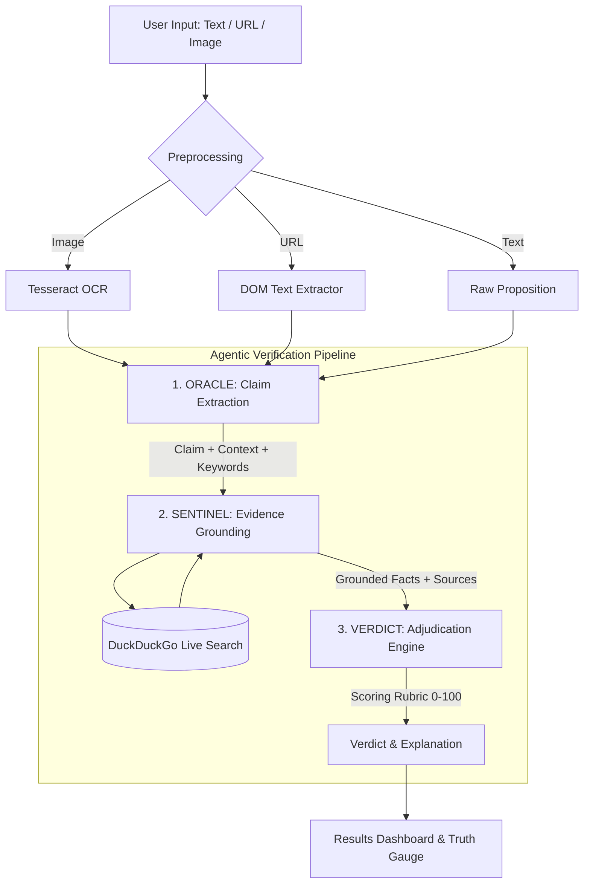

<div align="center">

# 🔍 TruthLens

**Multi-Agent Fact-Checking & Credibility Adjudication Engine**

*Isolate claims · Ground with live search evidence · Calibrate truth veracity*

[](https://python.org)
[](https://fastapi.tiangolo.com)
[](https://react.dev)
[](https://typescriptlang.org)
[](https://groq.com)
[](#)

</div>

---

## 📌 Overview

**TruthLens** is an agentic AI verification pipeline designed to combat misinformation by breaking fact-checking down into distinct, auditable cognitive stages:
1. **Proposition Extraction** — Stripping conversational noise to isolate atomic claims.
2. **Evidence Grounding** — Formulating search queries and retrieving live web consensus.
3. **Calibrated Adjudication** — Weighing evidence against a 0–100 rubric to issue structured truth scores.

TruthLens supports **multi-modal inputs** (raw statements, article URLs, and screenshots via client-side OCR) and offers **dual execution**:
- **Python Agent Backend** (`backend/`): High-throughput FastAPI service with multi-agent orchestration and live DuckDuckGo web search grounding.
- **Client-Side Fallback** (`src/`): Standalone browser runtime querying Groq directly with client-side Tesseract.js OCR.

---

## 🏗️ System Architecture



---

## 🤖 The Multi-Agent Pipeline

TruthLens implements a three-agent cognitive workflow:

### 1. ORACLE (Claim Extraction)
- **Role**: Isolates the core proposition from subjective opinions, hyperbole, or rhetorical questions.
- **Input**: Raw text string.
- **Output**: 
  - `claim`: The atomic, verifiable factual assertion.
  - `context`: Surrounding background context required to disambiguate pronouns or timelines.
  - `keywords`: 3–6 targeted terms for search indexing.
- **Location**: `backend/app/agents/oracle.py` (and `src/services/gemini.ts:runOracle`).

### 2. SENTINEL (Evidence Grounding)
- **Role**: Formulates targeted queries and gathers corroborating or refuting evidence from authoritative sources.
- **Input**: `OracleResult` (`claim`, `context`, `keywords`).
- **Grounding Mechanism**:
  - Dynamically synthesizes 3–4 adversarial search queries (e.g. `"<claim> fact check"`).
  - Queries public web indexes via `duckduckgo_search` to pull top URLs, titles, and real-time snippets.
  - Cross-references snippets against model parametric knowledge to filter out SEO spam.
- **Output**: 
  - `facts`: 4–8 itemized factual findings.
  - `sources`: Source objects containing `title`, `url`, and `domain`.
  - `queries`: Record of executed search terms.
  - `grounded`: Boolean flag (`true` when live web results were successfully retrieved).
- **Location**: `backend/app/agents/sentinel.py`.

### 3. VERDICT (Adjudication & Calibration)
- **Role**: Evaluates the claim against the retrieved evidence corpus and issues a calibrated verdict with corrections.
- **Input**: Both `OracleResult` and `SentinelResult`.
- **Scoring Rubric**:
  | Score Range | Category | Definition |
  | :--- | :--- | :--- |
  | **85 – 100** | `TRUE` | Fully supported by primary evidence and consensus. |
  | **70 – 84** | `MOSTLY TRUE` | Core claim verified; minor technical inaccuracies. |
  | **40 – 69** | `PARTIALLY TRUE` | Mixed support; lacks essential nuance or context. |
  | **15 – 39** | `MOSTLY FALSE` | Largely contradicted; contains minor true kernel. |
  | **0 – 14** | `FALSE` | Fabricated, debunked, or completely contradicted. |
  | *N/A* | `UNVERIFIABLE` | Insufficient public evidence to verify or refute. |
- **Output**:
  - `score`: Numeric veracity rating (0–100).
  - `verdict`: Strict categorical classification.
  - `explanation`: Detailed rationale explaining source corroboration or conflicts.
  - `corrections`: Bulleted list of specific factual inaccuracies.
- **Location**: `backend/app/agents/verdict.py`.

---

## ⚡ Tech Stack

- **Backend**: Python 3.11+, FastAPI, Pydantic v2, Groq SDK, DuckDuckGo Search (`duckduckgo-search`), Uvicorn.
- **Frontend**: React 19, TypeScript, Vite, Tailwind CSS v4, Framer Motion, Lucide React.
- **Multi-Modal**: Tesseract.js (client-side OCR), DOMParser.
- **Inference**: Groq LPU (GPT-OSS 120B / Llama 3.3 70B Versatile).

---

## 🚀 Getting Started

### Prerequisites
- Node.js 18+ & npm
- Python 3.10+
- A free Groq API key from [console.groq.com](https://console.groq.com/keys)

---

### 1. Run the Python Agent Backend

```bash
cd backend

# Create virtual environment
python -m venv venv

# Activate virtual environment
# Windows:
.\venv\Scripts\activate
# macOS/Linux:
source venv/bin/activate

# Install dependencies
pip install -r requirements.txt

# Configure your Groq key
cp .env.example .env
# Edit .env and paste your GROQ_API_KEY

# Launch the FastAPI server
python run.py
```
*Backend runs on `http://localhost:8000` (interactive API docs available at `http://localhost:8000/docs`).*

---

### 2. Run the React Frontend

In a separate terminal:

```bash
# In the project root
npm install

# Optional: configure API key in .env.local
cp .env.example .env.local

# Launch the Vite dev server
npm run dev
```
*Frontend runs on `http://localhost:5173`.*

> **Auto-Detection**: The frontend automatically checks `http://localhost:8000/health`. If the Python backend is active, it routes requests through the Python multi-agent pipeline with live web grounding. If offline, it smoothly falls back to browser-direct execution!

---

## 📊 Evaluation & Benchmarking Notes

- **Current Stage**: Working prototype (v1.0).
- **Manual Evaluation**: Tested across a benchmark of 30 hand-labeled claims (covering viral misinformation, historical facts, and recent news events) to tune scoring thresholds and prompt adherence.
- **Latency**: Sub-3-second average pipeline completion on Groq LPU endpoints.
- **Failure Resilience**: Automatic fallback from live search to parametric synthesis when internet/rate limits occur, gracefully tagging outputs as `grounded: false`.

---

## 📄 License

MIT © [TruthLens Team](https://github.com/pruthvibdev/Truthlens)
